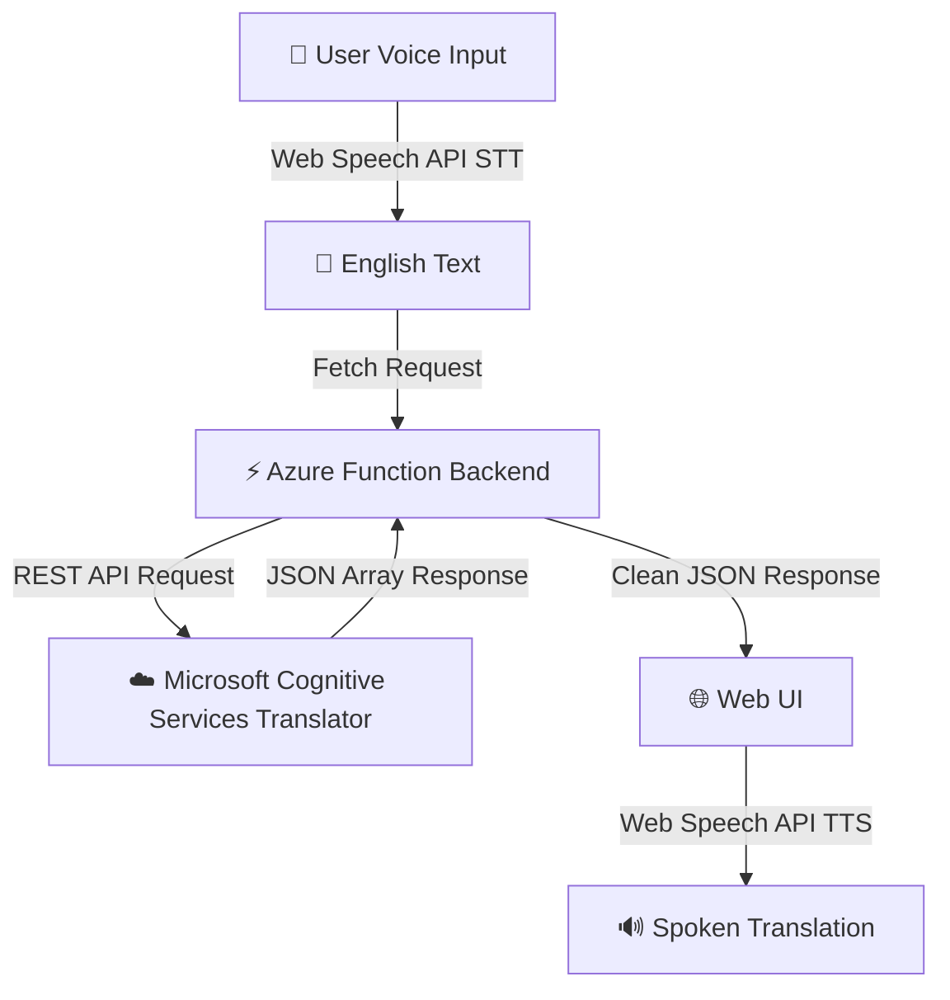

# 🌐 Azure Voice Translator

A premium, serverless Voice Translation application powered by **Azure Functions (Java 17)** and **Microsoft Cognitive Services Translator API**, paired with an interactive frontend that leverages the native browser **Web Speech API** for speech recognition (Speech-to-Text) and speech synthesis (Text-to-Speech).

---

## 🚀 Key Features

*   **🎙️ Real-time Voice Capture**: Uses the browser's Web Speech API to convert voice input into text instantly.
*   **⚡ Serverless Translation**: Backed by a secure Java Azure Function running on Java 17.
*   **🌍 Multi-Language Support**: Translates English text to regional languages including Kannada (`kn`), Hindi (`hi`), Tamil (`ta`), Telugu (`te`), and Marathi (`mr`).
*   **🔊 Audio Playback**: Read back the translated text using native Web Speech Synthesis.
*   **💾 Translation History**: Keeps a dynamic, local transaction history of translations in the current session.
*   **💻 Local Dev Auto-detection**: The frontend automatically routes API calls to the local functions host (`http://localhost:7071`) when run locally, and switches to the deployed Azure App Service in production.

---

## 🛠️ Architecture Flow



---

## 📂 Project Structure

```text
├── .github/workflows/
│   └── main_demovaibhavi.yml   # CI/CD Deployment Workflow
├── TranslatorApp/
│   ├── src/
│   │   ├── main/
│   │   │   ├── java/           # Java Backend Source (Azure Function)
│   │   │   └── resources/
│   │   │       └── wwwroot/    # Hosted Frontend Files
│   │   └── test/               # Java Backend Unit Tests
│   ├── pom.xml                 # Maven Dependencies & Configuration (Java 17)
│   ├── host.json               # Azure Function Host Configurations & CORS setup
│   ├── local.settings.json     # Local Environment Keys & Credentials
│   └── index.html              # Standalone local frontend for testing (Live Server)
├── README.md                   # Project Documentation
└── local.settings.json         # Workspace root settings duplicate/template
```

---

## ⚙️ Local Development Setup

### Prerequisites

1.  **Java Development Kit (JDK) 17**: Ensure Java 17 is installed on your local machine.
2.  **Azure Functions Core Tools**: Installed for running the functions host locally.
3.  **Live Server (VS Code Extension)**: To run the static frontend locally.
4.  **Azure Cognitive Services Translator Resource**: An active subscription key and endpoint.

---

### Step 1: Backend Configuration

1. Create a `local.settings.json` file inside the `TranslatorApp` directory if it does not exist.
2. Populate it with your Azure Translator API credentials:

```json
{
  "IsEncrypted": false,
  "Values": {
    "AzureWebJobsStorage": "UseDevelopmentStorage=true",
    "FUNCTIONS_WORKER_RUNTIME": "java",
    "TRANSLATOR_KEY": "YOUR_AZURE_TRANSLATOR_KEY",
    "TRANSLATOR_ENDPOINT": "https://api.cognitive.microsofttranslator.com",
    "TRANSLATOR_REGION": "YOUR_AZURE_RESOURCE_REGION"
  },
  "ConnectionStrings": {}
}
```

> [!WARNING]
> Never commit your production secrets/keys to your public git repository. The `local.settings.json` file is automatically ignored by `.gitignore`.

---

### Step 2: Running the Backend Locally

Open a terminal window, navigate to the `TranslatorApp` folder, and compile/run using Maven:

```bash
cd TranslatorApp
mvn clean package
mvn azure-functions:run
```

The serverless function will start locally, usually listing the HTTP trigger endpoint at:
`http://localhost:7071/api/TranslateFunction`

---

### Step 3: Running the Frontend Locally

1. Open `TranslatorApp/index.html` in VS Code.
2. Right-click and choose **Open with Live Server** (runs by default on port `5502`).
3. The frontend is pre-programmed to automatically detect that it's running on `localhost` and routes translation API calls to port `7071`.

---

## 📦 Deployment to Azure

This repository is set up with a GitHub Actions workflow `.github/workflows/main_demovaibhavi.yml` which deploys the function automatically on every push to the `main` branch.

### Prerequisites for GitHub Actions

1.  Ensure you have set up your Azure service credentials as Secrets in your GitHub repository:
    *   `AZUREAPPSERVICE_CLIENTID_618F08B56D364C02A2D684A9E6C4B9FF`
    *   `AZUREAPPSERVICE_TENANTID_1C6CADF5A733451EA3FF66021986751B`
    *   `AZUREAPPSERVICE_SUBSCRIPTIONID_77B148A66DB24CBA916A3CA051A48B76`
2.  Make sure the environment variables (`TRANSLATOR_KEY`, `TRANSLATOR_ENDPOINT`, `TRANSLATOR_REGION`) are added to the **Application Settings** section of the Azure Function App on the Azure Portal so that the deployed function can access them securely.

---

## 🏷️ How to Rename the GitHub Repository

If you want to rename this repository to something more professional (like `azure-voice-translator`):

1.  Go to the repository page on [GitHub](https://github.com).
2.  Click on the **Settings** tab (represented by a gear icon ⚙️ at the top of the repository navigation).
3.  Under the **General** section, locate the **Repository name** input box at the top.
4.  Change `azure-function` to `azure-voice-translator` (or your preferred name).
5.  Click **Rename**.
6.  Update your local Git remote URL in your terminal so it points to the renamed repo:
    ```bash
    git remote set-url origin https://github.com/vaibhavisnayak/azure-voice-translator.git
    ```